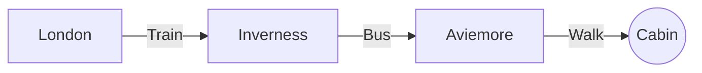

# Trip Planning

A long weekend in the mountains.

> [!TIP]
> Book the cabin before **Friday**, prices go up after that.

| Item | Per person |
| :--- | ---: |
| Cabin, 3 nights | £120 |
| Train | £45 |

$$
\text{total} = \sum_{i=1}^{3} c_i
$$

## Getting there

## Packing

- [x] Walking boots
- [ ] Head torch
